# Noční směna

Krátké hororové demo z pohledu první osoby pro prohlížeč (PC i mobil), ve stylu indie
found-footage hororů: low-poly modely, PS1 vzhled, nízké rozlišení, zrno a tma.
Je to vlastní hra s vlastním příběhem. Všechny modely, textury a zvuky vznikají
procedurálně v kódu.

**▶ Hrát: https://meinricek.github.io/test-game1/**

> Repozitář je teď **soukromý**. GitHub Pages ze soukromého repa jdou jen s placeným
> plánem (Pro/Team). Odkaz začne fungovat, až repo přepneš na veřejné (nebo budeš mít Pro)
> a v **Settings → Pages → Build and deployment → Source** zvolíš **GitHub Actions**.
> Pak stačí workflow *Deploy to GitHub Pages* spustit znovu (záložka Actions → Re-run).

Jde o demo jedné místnosti. Je noc, rodiče mají noční směnu a ty jsi doma sám.
Telefon zavibruje a z neznámého čísla přijde zpráva…

## Screenshoty

Vznikly automaticky v headless Chromiu (`npm run test:e2e`), viz [`/screenshots`](screenshots).

| | PC (1280×720) | Mobil (844×390, dotyk) |
|---|---|---|
| Úvodní obrazovka | 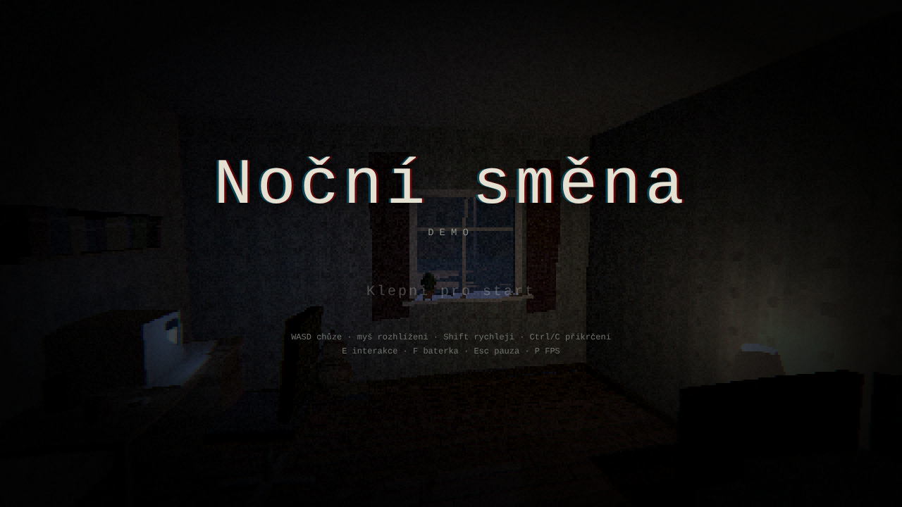 | 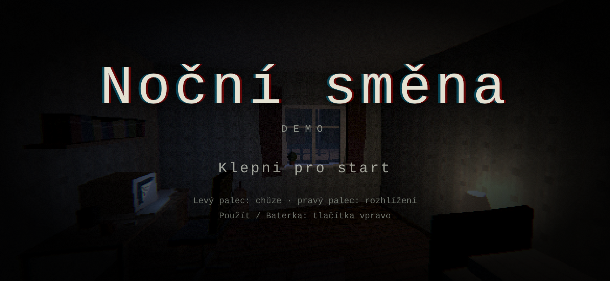 |
| Pokoj s rozsvícenou lampou | 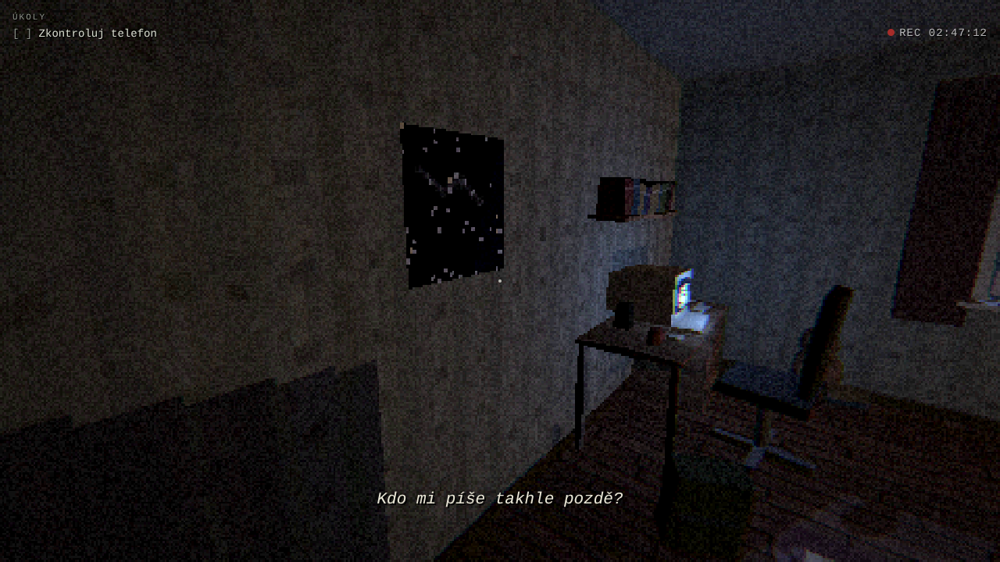 | 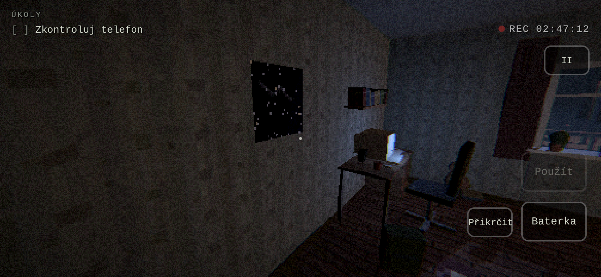 |
| Po zhasnutí, s baterkou | 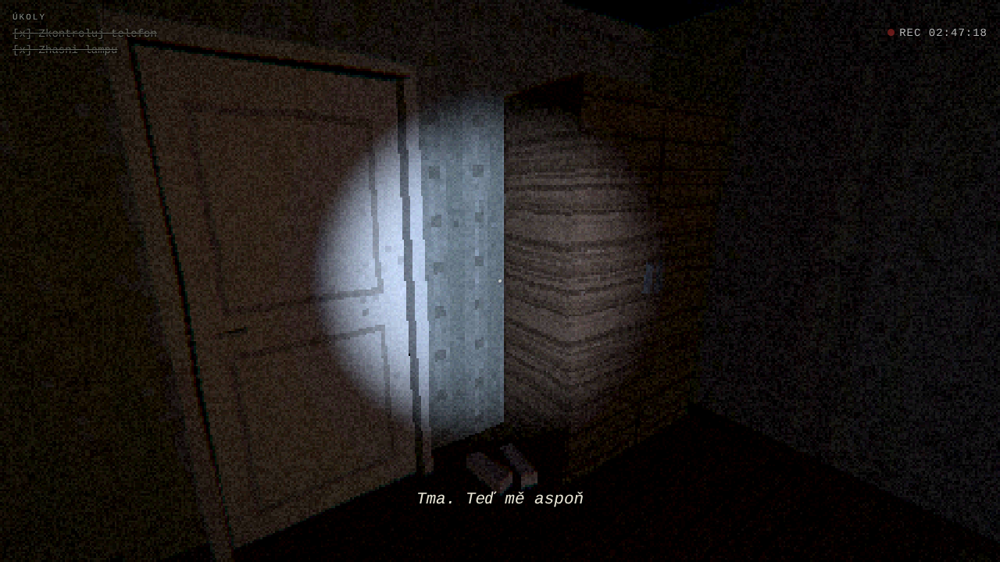 | 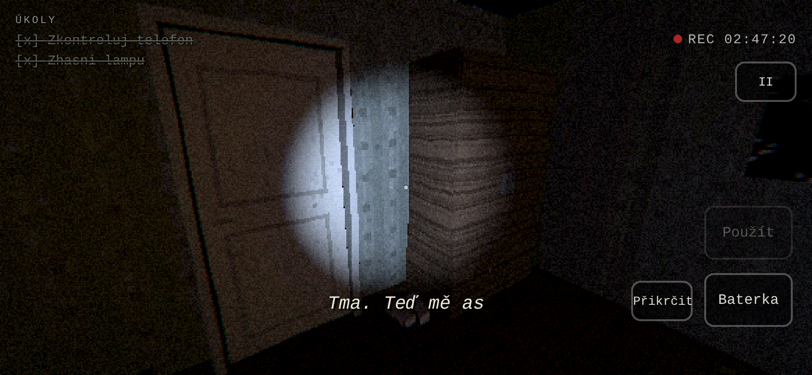 |
| Pohled z okna | 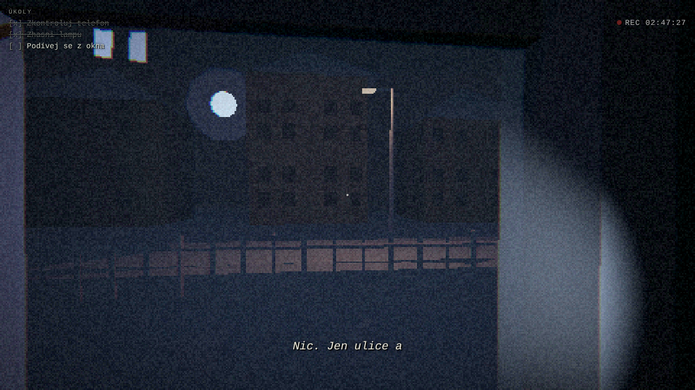 | 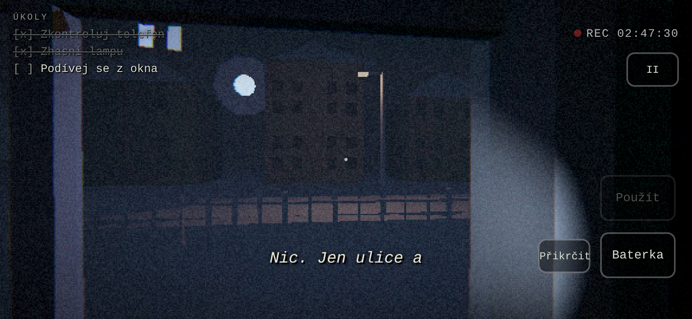 |
| Telefon v ruce | 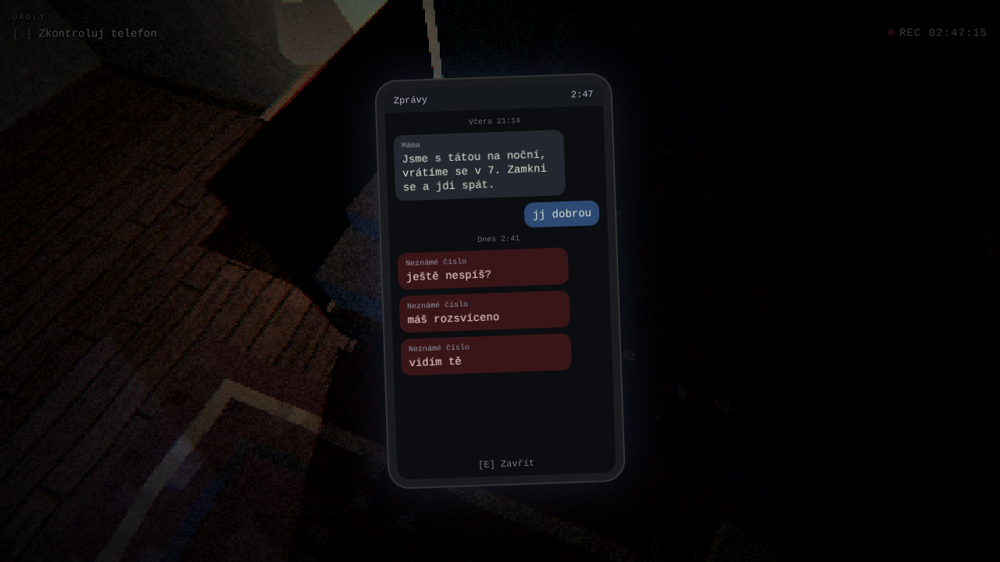 | 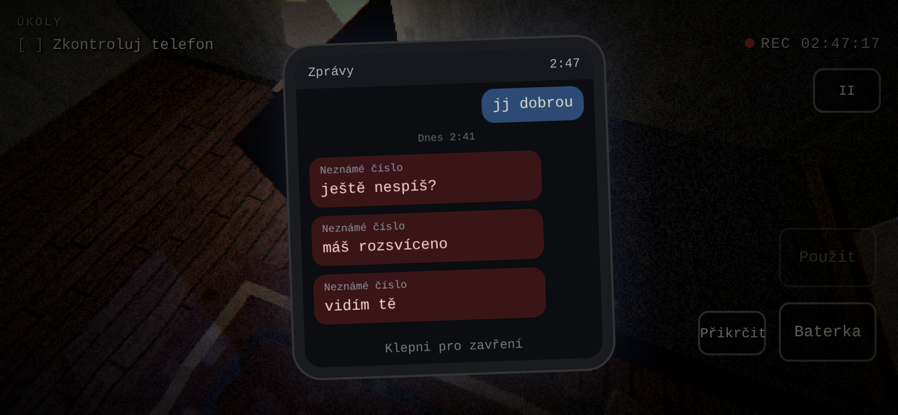 |
| Konec dema | 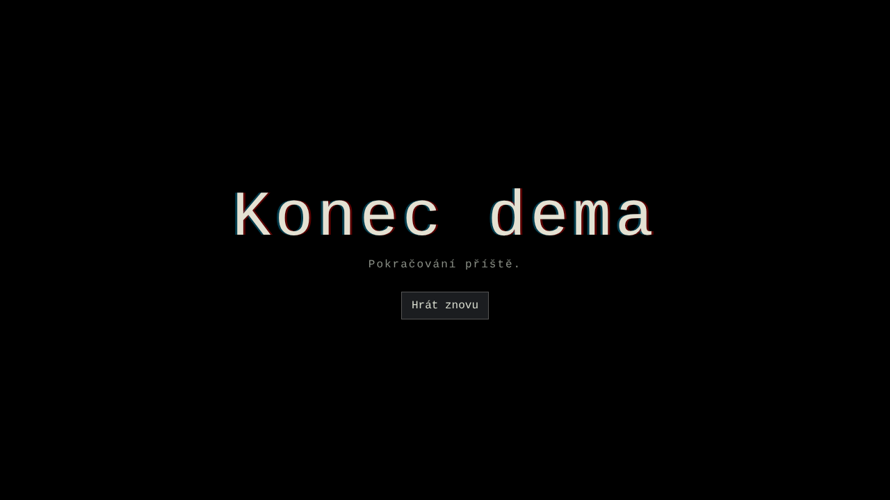 | 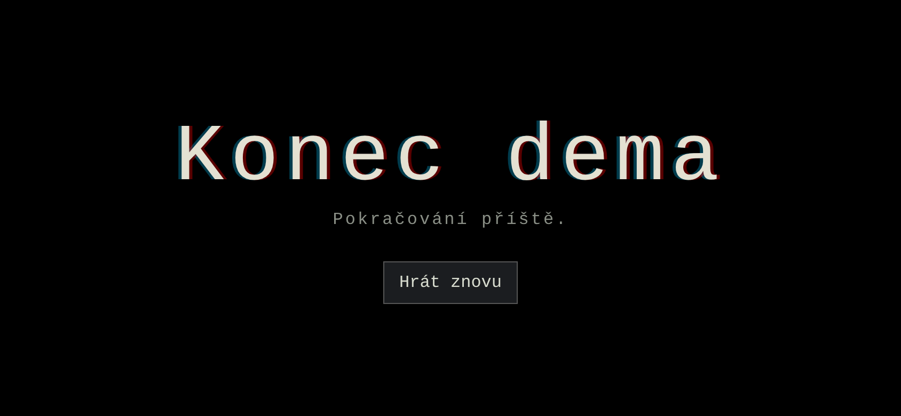 |
| Monitor | 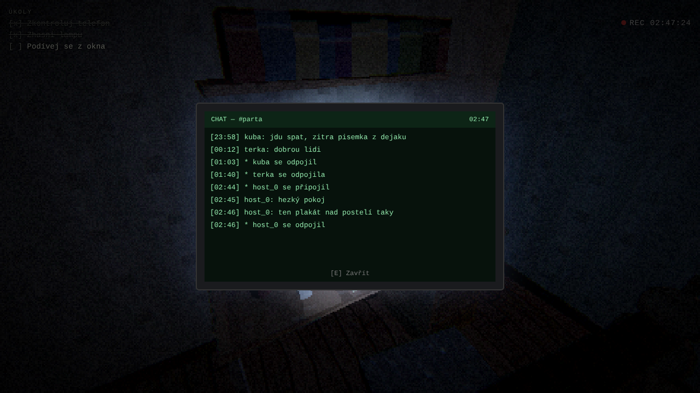 | 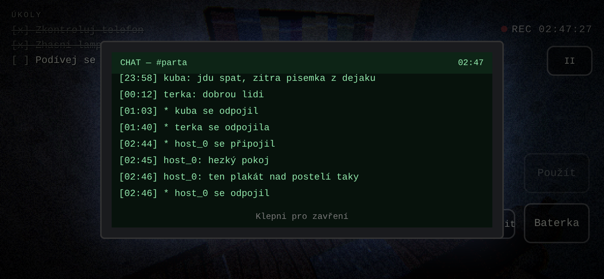 |
| Silueta za oknem | 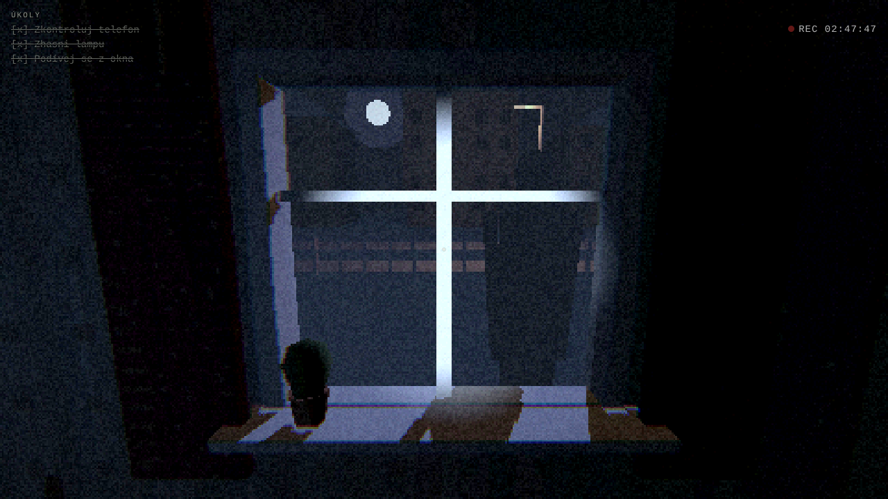 | 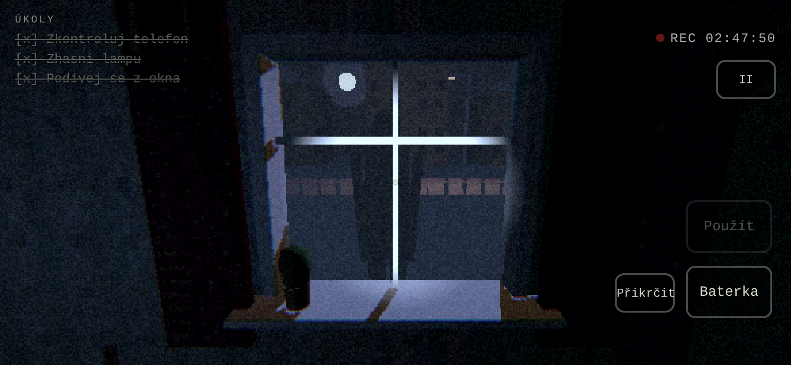 |
| Dveře se otevírají | 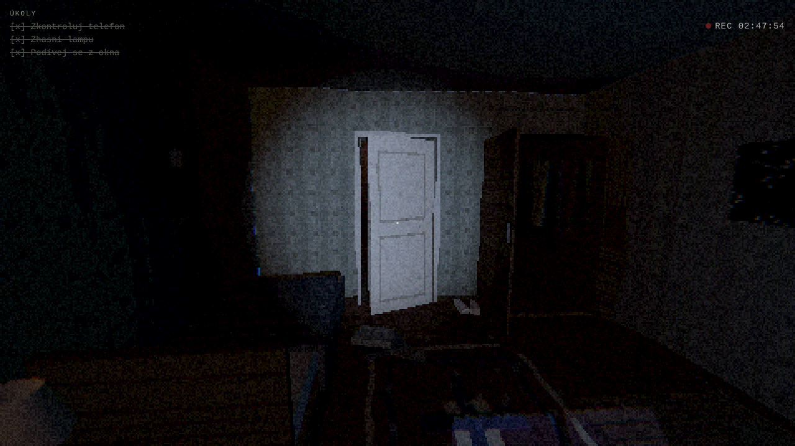 | 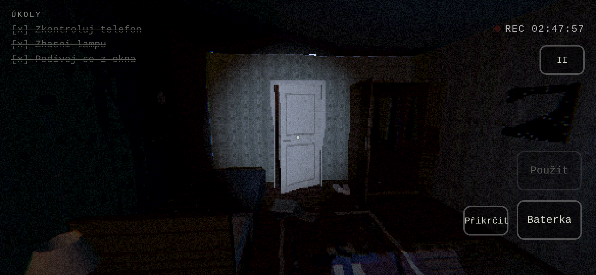 |

## Ovládání

| Akce | PC | Mobil |
|---|---|---|
| Chůze | WASD / šipky | virtuální joystick (levá část obrazovky) |
| Rozhlížení | myš (pointer lock po kliknutí) | tažení prstem v pravé části obrazovky |
| Rychlejší chůze | Shift | joystick vytlačený na doraz |
| Přikrčení | Ctrl (nebo C) | tlačítko „Přikrčit“ (přepínač) |
| Interakce | E | tlačítko „Použít“ (aktivní při zaměření objektu) |
| Baterka | F | tlačítko „Baterka“ |
| Pauza | Esc | tlačítko „II“ |
| Ukazatel FPS | P | v pauze („Ukazatel FPS“) |

Dotykové zařízení se pozná automaticky (`pointer: coarse` / touch events).
Úvodní obrazovka „Klepni pro start“ zároveň odemkne zvuk, protože mobilní prohlížeče
vyžadují gesto uživatele. Pauza obsahuje citlivost, hlasitost, PS1 efekt a FPS.
Nastavení se ukládají do `localStorage`.

> Ctrl+W zavře v prohlížeči záložku a hra to nemůže zablokovat, proto lze přikrčení
> ovládat i klávesou **C**.

## Spuštění

```bash
npm install
npm run dev        # vývojový server (http://localhost:5173, dostupný i z mobilu v síti)
npm run build      # produkční build do dist/
npm run preview    # náhled buildu
npm run test:e2e   # build musí existovat; projde celé demo v PC i mobilu a udělá screenshoty
```

Ke konzoli je při hraní připojený ladicí objekt `window.__game` / `window.__debug`
(např. `__debug.teleport(x, z, yaw, pitch)`, `__debug.state()`).

## Architektura

```
index.html                 – canvas + HTML overlay (HUD, pauza, telefon, titulky)
src/
  config.js                – NÁZEV HRY, rozlišení, post-process, rychlosti, výchozí nastavení
  main.js                  – vstupní bod + ladicí API
  core/
    Game.js                – hlavní smyčka, stavy (title/playing/paused/ended), načítání scén
    Renderer.js            – render do nízkého rozlišení → post-process shader → upscale bez vyhlazení
    PS1.js                 – vertex snapping + affine texturování (patch materiálů Three.js)
    Input.js               – klávesnice, myš/pointer lock, dotykový joystick a tlačítka
    Player.js              – FPS ovladač, kolize (kruh vs. AABB), přikrčení, head bob, baterka,
                             skriptované pohledy (lookAt, focus kamery)
    Scheduler.js           – časovače a tweeny v herním čase (během pauzy stojí)
    Textures.js            – procedurální low-res textury (canvas, NearestFilter, bez mipmap)
    Settings.js, EventBus.js
  systems/
    EventSystem.js         – datově řízené triggery (spouštěč + podmínka + seznam akcí)
    Actions.js             – knihovna akcí (zvuk, monolog, světlo, animace, fade, kamera…)
    Conditions.js          – vyhodnocení podmínek z dat
    InteractionSystem.js   – raycast ze středu obrazovky, výzvy „[E] …“
    DialogueSystem.js      – titulky/vnitřní monolog s psacím efektem
    ObjectiveSystem.js     – úkoly vlevo nahoře, postupné odemykání a odškrtávání
    AudioSystem.js         – Web Audio: ambient, kroky, klepání, cvaknutí, vrzání… (vše syntéza)
  scenes/
    BaseScene.js           – helpery pro stavbu místnosti (box, plane, kolize, registrace objektů)
    BedroomScene.js        – geometrie a světla pokoje
    index.js               – registr scén
  data/
    story.json             – startovní scéna a seznam scén
    dialogues.json         – všechny monology/titulky
    scenes/bedroom.json    – úkoly, interakce, telefon/monitor, příznaky a triggery pokoje
  ui/                      – UI.js + style.css
scripts/playtest.mjs       – automatický průchod demem (Playwright) + screenshoty
```

### Jak to do sebe zapadá

1. **Kód scény** (`BedroomScene.js`) postaví jen geometrii, světla a kolize a
   pojmenuje objekty, na které se odkazují data (`phone`, `lamp`, `door`, `lampLight`…).
2. **Data scény** (`bedroom.json`) říkají, co se s nimi děje:
   - `interactables`: co jde zaměřit a jaký text se ukáže (i podle podmínky),
   - `objectives`: úkoly a kdy jsou splněné (`doneWhen`),
   - `devices`: obsah telefonu a monitoru,
   - `triggers`: **spouštěč → podmínka → akce**.
3. **EventSystem** poslouchá na `EventBus` a spouští sekvence akcí (s čekáním).

Spouštěče (`on.type`): `start`, `interact`, `timer`, `lookAt` (pohled na objekt
po dobu X s), `flag`, `objectiveStart`, `objectiveComplete`, `allObjectivesComplete`, `custom`.

Akce (`type`): `wait`, `sound`, `ambient`, `monologue`, `objective`, `flag`, `light`,
`emissive`, `animate`, `visible`, `fade`, `text`, `lookAt`, `focusCamera`, `lockPlayer`,
`unlockPlayer`, `flashlight`, `device`, `shake`, `flash`, `interactable`, `collider`,
`emit`, `end`, `scene`. Každou lze podmínit vlastním `"if"` a `"wait": false` ji pustí
paralelně. Popis parametrů je v komentářích v `src/systems/Actions.js`.

Podmínky: `{ "flag": "lampOn", "eq": false }`, `{ "objectiveActive": "window" }`,
`{ "objectiveDone": "phone" }`, `{ "all": [...] }`, `{ "any": [...] }`, `{ "not": {...} }`, pole = AND.

Příklad, zhasnutí lampy:

```json
{
  "on": { "type": "interact", "target": "lamp" },
  "if": { "flag": "lampOn" },
  "actions": [
    { "type": "sound", "name": "click", "at": "lamp" },
    { "type": "light", "target": "lampLight", "on": false },
    { "type": "flag", "name": "lampOn", "value": false }
  ]
}
```

### Vzhled

- Scéna se renderuje do render targetu s výškou ~270 px (šířka podle poměru stran,
  na výšku orientovaný displej má 270 px kratší strana). Pak ho fullscreen shader roztáhne
  na canvas s `image-rendering: pixelated`.
- Post-process (`Renderer.js`): chromatická aberace, odsycení, kontrast, studený tón,
  vinětace, animované zrno a (s PS1 efektem) 15bit barvy s Bayer ditheringem.
- PS1 efekty (`PS1.js`): vrcholy se přichytávají na hrubou mřížku v clip space a UV se
  interpolují afinně (trik `uv*w / w`). Obojí se přepíná uniformou bez rekompilace shaderů.
- Světla: lampa (bodové, stíny), monitor, měsíc skrz okno (spot se stíny, kreslí kříž okna
  na podlahu), baterka (spot se stíny), pouliční lampa venku. Mlha `FogExp2`.
- Světla se vypínají přes `intensity = 0`, ne `visible`. Změna počtu světel by znamenala
  rekompilaci shaderů a záškub.

### Výkon

- Malé rozlišení (~480×270) drží fill-rate na minimu i na slabém mobilu.
- Na dotykových zařízeních je „low quality“: lampa bez stínů, menší stínové mapy.
- Lambert materiály, cca stovka draw callů, instancovaný plot, shadery se kompilují před startem.
- V headless Chromiu se softwarovým WebGL (SwiftShader, bez GPU) běží demo na ~20–35 FPS.
  Na skutečném mobilu s GPU je rezerva výrazně větší.

## Jak přidat novou scénu

1. **Geometrie:** vytvoř `src/scenes/HallwayScene.js`:
   ```js
   import { BaseScene } from './BaseScene.js';
   export class HallwayScene extends BaseScene {
     build() {
       const wall = this.mat({ color: 0x777777 });
       this.plane(4, 6, this.mat({ color: 0x443322 }), { rx: -90 });          // podlaha
       this.box(0.9, 2, 0.05, wall, { name: 'bathDoor', x: 1, z: -3, collider: true });
       // světla, kolize: this.addCollider(minX, maxX, minZ, maxZ)
     }
   }
   ```
   Objekty, na které se odkazují data, pojmenuj přes `name` / `this.register()`.
2. **Data:** vytvoř `src/data/scenes/hallway.json` se stejnou strukturou jako
   `bedroom.json` (`spawn`, `flags`, `objectives`, `interactables`, `devices`, `triggers`).
   Monology přidej do `src/data/dialogues.json`.
3. **Registrace:** přidej scénu do `src/scenes/index.js` (`hallway: { Scene: HallwayScene, data: hallway }`)
   a do `src/data/story.json`.
4. **Přechod:** v libovolném triggeru použij akci `{ "type": "scene", "id": "hallway" }`
   (např. místo `end` na konci pokoje).

Nový zvuk = nová funkce v `SOUNDS` v `AudioSystem.js`. Nová akce = nová položka v `ACTIONS`.

## Převod do Unity (poznámky)

Struktura odpovídá běžnému Unity projektu:
- `BaseScene`/`BedroomScene` → Unity scéna / prefab místnosti (low-poly modely lze
  vyexportovat ze scény Three.js přes `GLTFExporter`).
- `data/*.json` → ScriptableObjecty (nebo přímo JSON přes `JsonUtility`), stejné
  triggery/akce/podmínky.
- `EventSystem` + `Actions` → `MonoBehaviour` s coroutinami (`wait` = `yield return new WaitForSeconds`).
- `PS1.js` + post-process → URP shader (vertex snapping, affine UV) + Render Texture 480×270 s point filtrem.
- `Player.js` → `CharacterController` (kolize zajistí fyzika).

## Licence a zdroje

Viz [CREDITS.md](CREDITS.md). Žádné externí assety nejsou použité.
